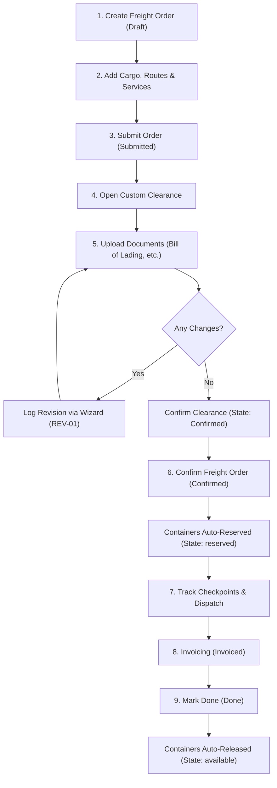

# Hammad FMS - Freight Management System for Odoo 19

A comprehensive, modular Freight Management System (FMS) built for **Odoo 19** to manage and streamline end-to-end logistics operations across **Land (FTL/LTL)**, **Air**, and **Water/Ocean (FCL/LCL)** transport modes.

---

## 📌 Table of Contents
1. [Overview](#-overview)
2. [Key Features](#-key-features)
3. [Architecture & Models](#-architecture--models)
4. [Functional Workflow](#-functional-workflow)
5. [Customs Clearance & Compliance](#-customs-clearance--compliance)
6. [Security & Multi-Company Architecture](#-security--multi-company-architecture)
7. [Automated Testing](#-automated-testing)
8. [Installation & Setup](#-installation--setup)

---

## 🚀 Overview

**Hammad FMS (`trn_freight`)** handles end-to-end freight forwarding operations:
- Managing multi-modal transport (Land, Air, Sea).
- Rating and billing cargo lines dynamically based on weight or volume.
- Routing shipments through verified ports and calculating leg-by-leg transit costs.
- Managing vendor-specific additional logistics services.
- Real-time container inventory tracking (automatic reservation on confirmation and release upon delivery).
- Regulatory compliance via integrated Customs Clearance, document attachment storage, and revision audits.
- Multi-company data isolation and role-based permissions.

---

## 🌟 Key Features

- **Multi-Modal Shipping**: Support for Land (`FTL`/`LTL`), Air, and Water (`FCL`/`LCL`).
- **Dynamic Pricing Engine**: Automated calculation of cargo costs based on Weight (per KG) or Volume (per CBM).
- **Port Transport Verification**: Strict constraints preventing incompatible port selection (e.g. airport for sea freight).
- **Smart Container Tracking**: Auto-reserves containers when order is confirmed (`available` ➔ `reserved`), and frees them when completed (`reserved` ➔ `available`).
- **Customs Clearance Gatekeeper**: Shipments cannot be confirmed without an approved Customs Clearance.
- **Audit Revision Wizard**: Interactive popup wizard for customs revisions (`REV-01`, `REV-02`) with reason logging.
- **Milestone Tracking**: Checkpoint logging with source, destination, transport mode, and status (`Received` / `Delivered`).
- **Multi-Company Compliant**: Built from the ground up with `res.company` record rules and stored related company fields.

---

## 🏗️ Architecture & Models

```
┌────────────────────────────────────────────────────────────────────────┐
│                        Master Data / Configuration                     │
├─────────────────┬──────────────────┬─────────────────┬─────────────────┤
│  freight.port   │ freight.container│  freight.price  │ freight.routes  │
│ (Air/Land/Water)│(Weight/Vol/State)│ (Weight/Vol Prc)│ (Transport Prc) │
└────────┬────────┴────────┬─────────┴────────┬────────┴────────┬────────┘
         │                 │                  │                 │
         ▼                 ▼                  ▼                 ▼
┌────────────────────────────────────────────────────────────────────────┐
│               freight.shipping (Main Freight Order)                    │
│      [Draft] ──► [Submitted] ──► [Confirmed] ──► [Invoiced] ──► [Done] │
├─────────────────┬──────────────────┬─────────────────┬─────────────────┤
│   cargo_ids     │    route_ids     │   service_ids   │    track_ids    │
│(Container/Goods)│ (Legs & Pricing) │(Vendor Services)│ (Status Updates)│
└─────────────────┴────────┬─────────┴─────────────────┴─────────────────┘
                           │
                           ▼
┌────────────────────────────────────────────────────────────────────────┐
│                     Customs Clearance & Revisions                      │
├────────────────────────────────────┬───────────────────────────────────┤
│          custom.clearance          │       custom.clearance.line       │
│  (Header & Order Synchronization)  │    (Binary Document Attachments)  │
├────────────────────────────────────┼───────────────────────────────────┤
│     custom.clearance.revision      │        clearance.revision         │
│     (TransientModel Popup Wizard)  │     (Permanent Revision Audit)    │
└────────────────────────────────────┴───────────────────────────────────┘
```

### 1. Configuration & Master Data Models
* **`freight.port`**: Ports and dry-ports with capability flags (`is_land`, `is_air`, `is_water`).
* **`freight.container`**: Standard shipping equipment with dimensional capacities (`size`, `weight`, `volume`) and status tracking (`available`, `reserved`).
* **`freight.price`**: Slabs for weight-based and volume-based cargo billing.
* **`freight.routes`**: Transit legs with mode-specific pricing (`land_price`, `air_price`, `water_price`).
* **`freight.service` & `freight.service.line`**: Additional services (e.g. Fumigation, Handling, Packaging) with vendor-negotiated rates.

### 2. Main Operational Models
* **`freight.shipping`**: Core freight order record with automatic sequencing (`ir.sequence`: `FO/YYYY/XXXXX`), partner associations (Shipper, Consignee, Agent), and total computations (`cargo_total`, `total_weight`, `total_volume`, `routes_total`, `service_total_sale`).
* **`freight.order.cargo`**: Cargo items referencing containers and goods with automated rate calculation.
* **`freight.order.route`**: Route lines with validation against transport capabilities of source and destination ports.
* **`freight.order.service`**: Vendor-specific service lines with quantity and total calculation.
* **`freight.order.track`**: Live checkpoint audit trail.

### 3. Customs Clearance Models
* **`custom.clearance`**: Synchronized record linked to freight order (`CC - <Order Name>`).
* **`custom.clearance.line`**: Document management for Bill of Lading, Invoices, Packing Lists with `fields.Binary(attachment=True)`.
* **`clearance.revision`**: Permanent audit log of changes made to customs filings.
* **`custom.clearance.revision`**: Transient wizard prompting for revision reason and note.

---

## 🔄 Functional Workflow



1. **Order Creation (`draft`)**: Shipper, Consignee, Transport Mode, Loading Port, and Discharging Port are defined.
2. **Cargo Specification**: Lines added with container, goods, weight/volume, and billing rule.
3. **Submission (`submitted`)**: Order locked for operational review.
4. **Customs Clearance**: Clearance record accessed directly via button. Supporting documents uploaded and verified.
5. **Confirmation (`confirmed`)**: 
   * Strict validation ensures clearance is confirmed.
   * Linked containers automatically transition to `reserved`.
6. **Execution & Tracking**: Checkpoints recorded via the tracking wizard.
7. **Completion (`done`)**: Shipment marked complete; all allocated containers return to `available`.

---

## 🛡️ Security & Multi-Company Architecture

### Security Groups
* **Freight User (`base.group_user`)**: Read and write access to orders, lines, and clearances.
* **Freight Manager (`group_freight_manager`)**: Administrative privileges including delete operations and configuration management.

### Multi-Company Isolation
All primary and child models enforce company-level data isolation:
* `freight.shipping`, `custom.clearance`, `freight.container`, `freight.port`, `freight.routes`, `freight.price`, and `freight.service` maintain explicit `company_id` fields with record rules:
  ```xml
  ['|', ('company_id', '=', False), ('company_id', 'in', company_ids)]
  ```
* Child line models utilize stored related fields (`related='order_id.company_id', store=True`) to guarantee performant and secure query filtering.

---

## 🧪 Automated Testing

Automated test suites ensure regression-free stability:
* **`test_freight_order.py`**:
  * Sequence generation on create.
  * Cargo price computations (weight-based vs volume-based).
  * Port transport mode validation constraints.
  * Order lifecycle progression (`draft` ➔ `submitted` ➔ `confirmed` ➔ `done`).
  * Container state reservation and auto-release.
  * Customs clearance requirement enforcement on order confirmation.
  * Order and clearance deletion constraints.
* **`test_security.py`**:
  * Multi-company record rule isolation across different company environments.

Run tests using the Odoo CLI:
```bash
odoo-bin -c /path/to/odoo.conf -d <database_name> --test-enable --stop-after-init -i trn_freight
```

---

## 💻 Installation & Setup

1. **Clone the Repository**:
   ```bash
   cd /path/to/custom_addons/
   git clone git@github.com:hammadakbarcoder-arch/freight-management.git
   ```

2. **Add to `odoo.conf`**:
   Ensure `freight-management` (or its parent directory containing `trn_freight`) is included in your `addons_path`:
   ```ini
   addons_path = /path/to/odoo/addons,/path/to/custom_addons/freight-management
   ```

3. **Install the Module**:
   * Activate Developer Mode in Odoo.
   * Navigate to **Apps ➔ Update Apps List**.
   * Search for **`trn_freight`** (Freight Management) and click **Activate**.
