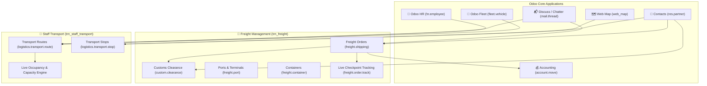

# 🌐 Hammad FMS & Logistics Transport Suite for Odoo 19

[](https://www.odoo.com)
[](https://www.python.org)
[](https://www.postgresql.org)
[](https://www.gnu.org/licenses/lgpl-3.0.html)
[](#-automated-testing-suites)
[](#-modular-architecture)

A production-grade, enterprise-ready logistics and corporate transport ecosystem built natively for **Odoo 19**. This repository hosts two complementary, high-performance modules designed to manage global freight forwarding operations and corporate employee commute logistics seamlessly.

---

## 📌 Repository Table of Contents
1. [Modular Suite Overview](#-modular-suite-overview)
2. [Architecture & Odoo Integration Diagram](#-modular-architecture)
3. [Module 1: Freight Management (`trn_freight`)](#-module-1-freight-management-trn_freight)
4. [Module 2: Staff Transport (`trn_staff_transport`)](#-module-2-staff-transport-management-trn_staff_transport)
5. [Enterprise Security & Multi-Company Architecture](#-enterprise-security--multi-company-architecture)
6. [Automated Testing Suites](#-automated-testing-suites)
7. [Repository File Hierarchy](#-repository-file-hierarchy)
8. [Installation & Setup](#-installation--setup)

---

## 📦 Modular Suite Overview

| Attribute | 🚢 `trn_freight` (Freight Forwarding) | 🚐 `trn_staff_transport` (Staff Transport) |
| :--- | :--- | :--- |
| **Primary Domain** | Global cargo, multi-modal shipments & customs | Corporate employee commute & fleet allocation |
| **Target Users** | Freight forwarders, logistics coordinators, shippers | HR officers, fleet managers, route dispatchers |
| **Key Odoo Dependencies** | `contacts`, `account`, `mail` | `hr`, `fleet`, `contacts`, `mail`, `web_map` |
| **Primary Models** | `freight.shipping`, `custom.clearance`, `freight.port` | `logistics.transport.route`, `logistics.transport.stop` |
| **Core Innovations** | Dynamic CBM/KG rating, container reservation, PDF engine | Drag-handle sequencing, capacity % bar, Google Maps GPS |
| **Test Coverage** | 11 comprehensive automated tests (`test_freight_order.py`) | 5 automated tests (`test_staff_transport.py`) |

---

## 🏗️ Modular Architecture

Both modules adhere strictly to Odoo's recommended extension guidelines (`_inherit` without `_name` for clean in-place extensions and dedicated XPath locators for zero-conflict UI view inheritance).



---

## 🚢 Module 1: Freight Management (`trn_freight`)

`trn_freight` provides an end-to-end operational backbone for international and domestic freight forwarders.

### Key Capabilities:
* **Multi-Modal Transit**: Full operational lifecycle management across **Land** (`FTL`/`LTL`), **Air**, and **Water/Ocean** (`FCL`/`LCL`) shipping modes.
* **Dynamic Cargo Rating Engine**: Automated calculation of cargo line items based on Gross Weight (per KG) or Volume (per CBM), charging the higher commercial metric automatically.
* **Port Transport Verification**: Strict `@api.constrains` preventing invalid mode selections (e.g. assigning airports to sea freight).
* **Smart Container Inventory**: Real-time container state machine automatically reserving containers upon order confirmation (`available` ➔ `reserved`) and releasing them upon delivery (`reserved` ➔ `available`).
* **Customs Clearance Gatekeeper**: Strict confirmation gate blocking shipment confirmation until legal customs clearance is approved.
* **Audit Revision Wizard**: Interactive popup wizard recording formal customs amendments (`REV-01`, `REV-02`) with reason auditing.
* **Accounting Invoice Integration**: 1-Click invoice generation creating validated customer invoices (`account.move`) with itemized conversion for Cargo, Leg Routes, and Surcharges.
* **Backend Data Integrity Locks**: Python-level ORM locks blocking modification of cargo lines on confirmed orders and route/service lines on invoiced orders.
* **Live Checkpoint Notifications**: Checkpoint logging with automated chatter notifications dispatched to Shipper, Consignee, and Customs Agents.
* **QWeb PDF Reports**: Clean, executive-ready printable PDF documents for Freight Orders and Shipment Timelines with repeating table headers.

---

## 🚐 Module 2: Staff Transport Management (`trn_staff_transport`)

`trn_staff_transport` extends standard Odoo Fleet and HR applications to coordinate staff pickup, drop-off routes, vehicle capacity, and navigation.

### Key Capabilities:
* **Master Routes & Stops Architecture**:
  * Comprehensive route planning (`logistics.transport.route`) supporting `Pickup`, `Drop-off`, and `Both` direction schedules.
  * Stops model (`logistics.transport.stop`) linked directly to partner physical addresses.
* **Interactive Drag-and-Drop Sequencing**:
  * Utilizes `widget="handle"` on the sequence field in List Views to allow dispatchers to reorder route stops visually.
* **Dual Mapping Engine**:
  * **Interactive Leaflet/OpenStreetMap**: Native Odoo map view plotting route stops chronologically with stop markers.
  * **Live Google Maps GPS Action**: Header action button dynamically constructing Google Maps turn-by-turn navigation URLs with origin, destination, and intermediate waypoints:
    $$\text{URL: } \texttt{https://www.google.com/maps/dir/?api=1\&origin=...&destination=...&waypoints=...}$$
* **Fleet Seating Capacity & Trips Counter**:
  * Non-destructive model extension on `fleet.vehicle` adding `seat_capacity_override` and computed `effective_capacity`.
  * Dedicated `Trips` smart button displaying the count and list of active routes assigned to each vehicle.
* **Clean Employee Form XPath Injection**:
  * Injects a dedicated **"Transport"** notebook tab into `hr.view_employee_form` via clean XPath.
  * Real-time route stop assignment with strict `@api.constrains` blocking mismatched stops.
  * Dynamic `@api.onchange` automatically clearing invalid stops if an employee's route is altered.
* **Live Occupancy Dashboard**:
  * Formula-driven vehicle capacity utilization:
    $$\text{Occupancy \%} = \frac{\text{Assigned Employees}}{\text{Vehicle Capacity}} \times 100$$
  * Formatted with Odoo's native visual percentage widget (`widget="percentage"`).
* **Odoo 19 Compliant Search Views**:
  * Clean, modern `<search>` views for Routes and Stops featuring 1-click Quick Filters (`Pickup`, `Drop-off`, `Both`, `Assigned Vehicle`) and hierarchical Group By dropdowns.

---

## 🛡️ Enterprise Security & Multi-Company Architecture

Both modules implement rigorous role-based access control (RBAC) and strict multi-company data isolation.

### Security Roles Matrix

| Module | Group Name | Permissions | Primary Responsibilities |
| :--- | :--- | :---: | :--- |
| **`trn_freight`** | Freight User (`base.group_user`) | `1, 1, 1, 0` | Daily shipment entry, cargo logging, line tracking. |
| **`trn_freight`** | Freight Manager (`group_freight_manager`) | `1, 1, 1, 1` | Order deletion, customs approval, financial invoicing. |
| **`trn_staff_transport`** | Transport User (`group_staff_transport_user`) | `1, 1, 1, 0` | View routes, assign employee stops, view maps (No Delete). |
| **`trn_staff_transport`** | Transport Administrator (`group_staff_transport_manager`) | `1, 1, 1, 1` | Full administrative control, route deletion, capacity overrides. |

### Multi-Company Isolation Rules
Every model enforces company-level tenancy rules:
```xml
['|', ('company_id', '=', False), ('company_id', 'in', company_ids)]
```
Records created under Company A remain completely invisible and inaccessible to users logged into Company B, verified via automated test assertions.

---

## 🧪 Automated Testing Suites

All business logic, security constraints, and mathematical computations are protected against regressions by automated Python test suites.

```
----------------------------------------------------------------------
Ran 5 tests in 1.32s (trn_staff_transport)
Ran 11 tests in 3.45s (trn_freight)

OK - 0 Failed, 0 Errors (100% Pass)
----------------------------------------------------------------------
```

### Running Test Suites via CLI:

#### 1. Run Staff Transport Tests:
```bash
python odoo-bin -c /path/to/odoo.conf -d <db_name> --http-port=8070 --test-enable --test-tags=/trn_staff_transport --stop-after-init
```

#### 2. Run Freight Management Tests:
```bash
python odoo-bin -c /path/to/odoo.conf -d <db_name> --http-port=8070 --test-enable --test-tags=/trn_freight --stop-after-init
```

---

## 📁 Repository File Hierarchy

```text
freight-management/
├── .gitignore
├── LEARNING_LOG.md                     # Comprehensive senior developer interview questions & answers
├── README.md                           # Main suite documentation
│
├── trn_freight/                        # Module 1: Freight Management System
│   ├── __init__.py
│   ├── __manifest__.py
│   ├── models/
│   │   ├── freight_shipping.py         # Master freight order lifecycle & line locks
│   │   ├── custom_clearance.py         # Customs clearance gatekeeper & revision wizard
│   │   ├── freight_port.py             # Sea, Air, and Land ports with validation
│   │   ├── freight_container.py        # Container inventory & state management
│   │   ├── freight_routes.py           # Multi-leg transit cost calculator
│   │   ├── freight_pricing.py          # Dynamic CBM vs Weight pricing engine
│   │   └── freight_service.py          # Additional logistics surcharges
│   ├── views/                          # Clean list, form, search, and menu views
│   ├── security/                       # RBAC access rules & multi-company policies
│   ├── report/                         # QWeb PDF reports & templates
│   └── tests/                          # Automated test cases
│
└── trn_staff_transport/                # Module 2: Staff Transport Management
    ├── __init__.py
    ├── __manifest__.py
    ├── models/
    │   ├── transport_route.py          # Master routes, capacity calculations, map actions
    │   ├── transport_stop.py           # Stops, sequence ordering, address links
    │   ├── fleet_vehicle.py            # Fleet extension (capacity override, trips button)
    │   └── hr_employee.py              # HR extension (transport tab, constraints, onchange)
    ├── views/
    │   ├── transport_route_views.xml   # Route views, map header buttons, search filters
    │   ├── transport_stop_views.xml    # Stops list with drag handles & map view
    │   ├── fleet_vehicle_views.xml     # Clean XPath fleet vehicle extension
    │   ├── hr_employee_views.xml       # Clean XPath employee notebook extension
    │   └── transport_menus.xml         # Top-level menus
    ├── security/
    │   ├── transport_security.xml      # User & Admin groups, multi-company rules
    │   └── ir.model.access.csv         # CRUD permissions
    └── tests/
        ├── __init__.py
        └── test_staff_transport.py     # 5 comprehensive automated tests
```

---

## 💻 Installation & Setup

1. **Clone the Repository**:
   ```bash
   cd /path/to/odoo/custom_addons/
   git clone git@github.com:hammadakbarcoder-arch/freight-management.git
   ```

2. **Configure `odoo.conf`**:
   Add the repository directory to your `addons_path`:
   ```ini
   addons_path = /path/to/odoo/addons,/path/to/odoo/custom_addons/freight-management
   ```

3. **Install the Modules**:
   * Restart your Odoo server.
   * Activate **Developer Mode** in Odoo Settings.
   * Navigate to **Apps ➔ Update Apps List**.
   * Search for **`trn_freight`** and **`trn_staff_transport`** and click **Activate**.

---

### 👨‍💻 Author & Maintainer
* **Author**: Hammad Akbar
* **License**: LGPL-3
* **Odoo Version**: 19.0 Community & Enterprise
